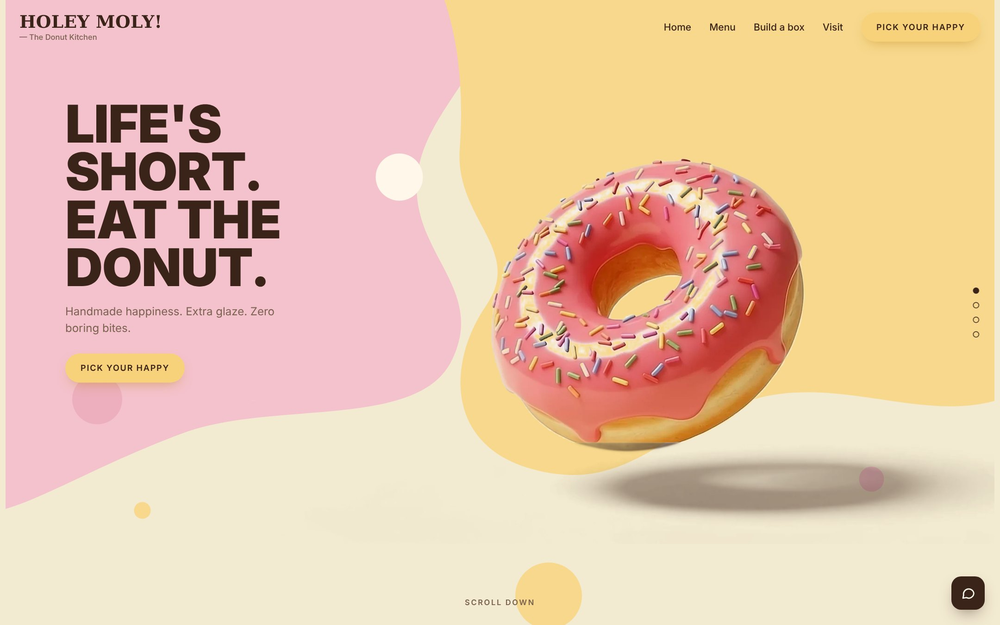
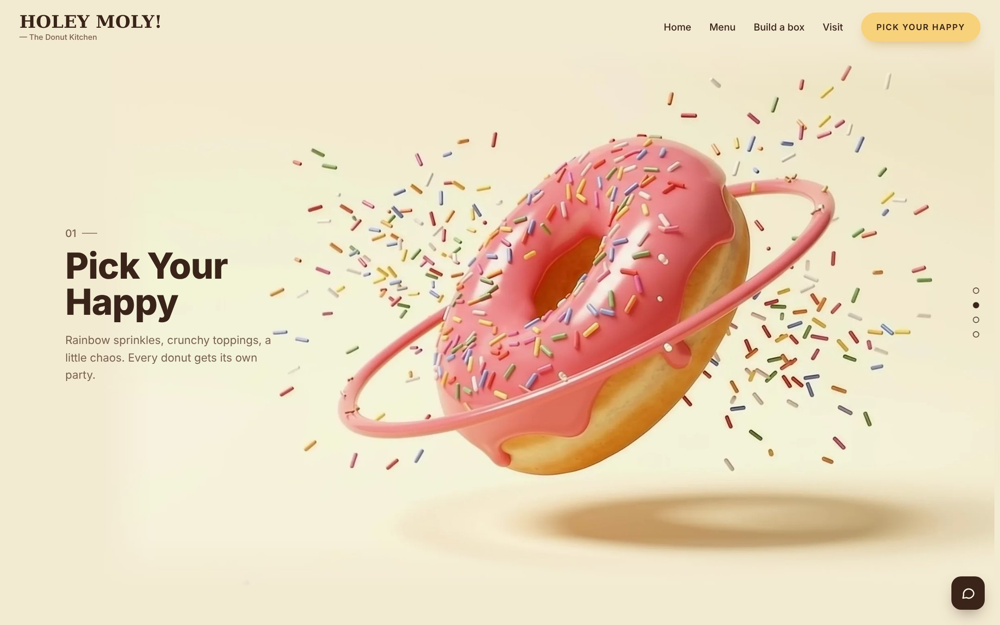
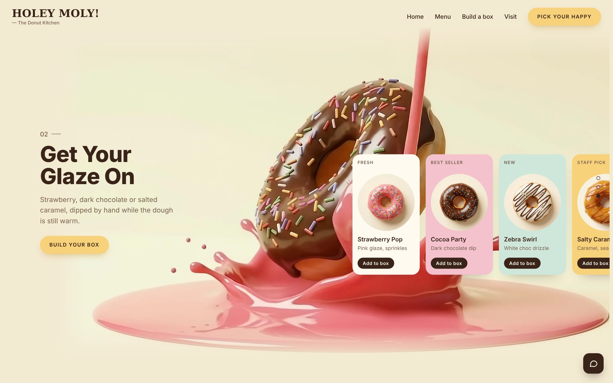
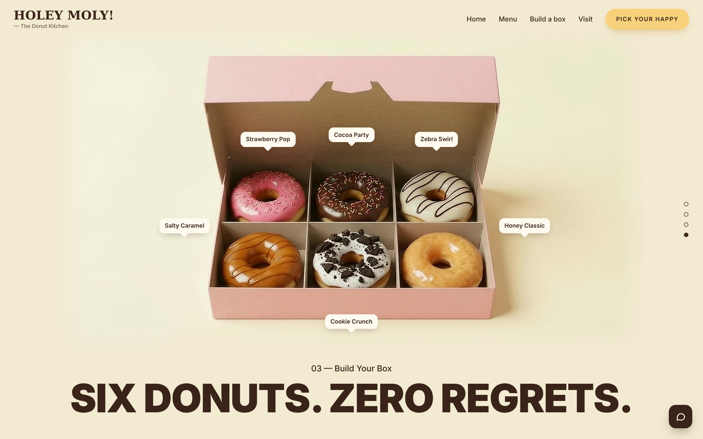
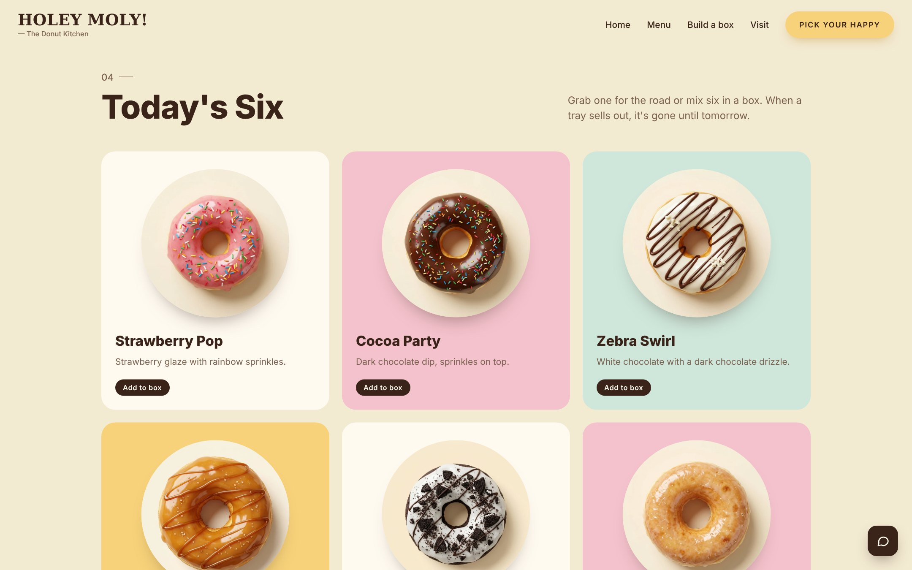
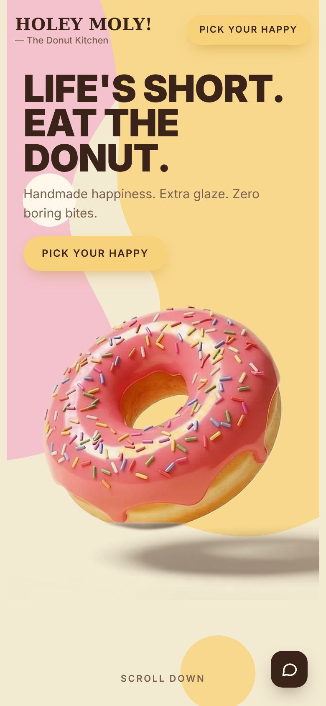
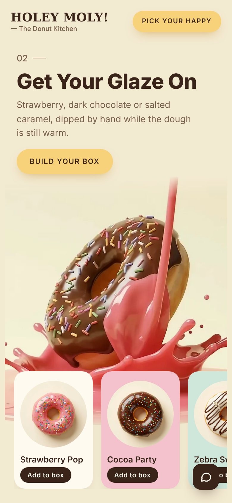
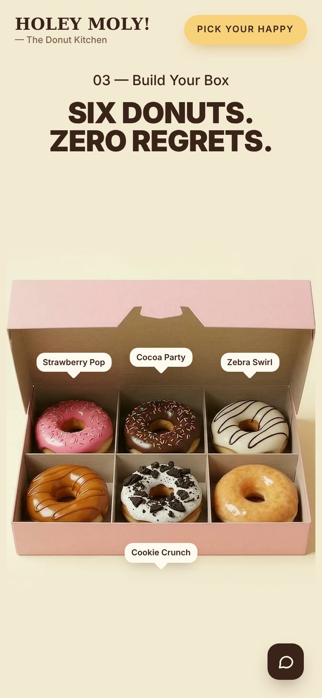

# Holey Moly! — The Donut Kitchen

A scroll-driven website concept for a donut shop. As you scroll, a donut spins through a burst of sprinkles, gets dipped in pink glaze, turns chocolate, and drops into a box that fills up with six flavours.



## The scroll story

| 01 · Pick Your Happy | 02 · Get Your Glaze On |
|---|---|
|  |  |

| 03 · Build Your Box | Menu |
|---|---|
|  |  |

### On mobile

| Hero | Glaze | Box |
|---|---|---|
|  |  |  |

## How it works

- **Image-sequence animation.** Four AI-generated video clips were cut into WebP frames. A `<canvas>` draws the frame that matches the scroll position, so the motion plays forwards and backwards with the scrollbar.
- **Two frame sets.** Desktop loads 288 frames at 2400 px; phones load 144 frames at 1280 px to stay light and smooth.
- **Hero cut-out.** The first frame's donut was cut out with an alpha mask so it can sit on top of the illustrated pink and yellow background, then cross-fades into the video frames on the first scroll.
- **Pinned stage.** The canvas sits in a sticky full-screen stage. Text panels scroll in from below and out above, and the frame is re-framed per section (shifted, zoomed out for the box).
- **Smooth scrolling** with [Lenis](https://github.com/darkroomengineering/lenis), falling back to native scrolling when it isn't available or when the visitor prefers reduced motion.
- No build step, no framework: one `index.html` with inline CSS and JavaScript.

## Project structure

```
index.html        the whole site
frames/           desktop frames (f001–f288.webp)
m/                mobile frames (f001–f144.webp)
cut_d.webp        hero donut cut-out, desktop
cut_m.webp        hero donut cut-out, mobile
img/              menu and product-card donut images
screenshots/      images used in this README
```

## Run it locally

The frames are loaded with relative paths, so serve the folder over HTTP rather than opening the file directly:

```bash
python3 -m http.server 8000
# then open http://localhost:8000
```

To publish it, turn on **GitHub Pages** for this repo (Settings → Pages → Deploy from branch → `main` / root).

## Credits

- Design and development: [Tuqa Dahab](https://www.linkedin.com/in/tuqa-dahab)
- Visuals: AI image generation for the key frames and product shots, AI video generation for the transitions
- Fonts: Rubik and Alfa Slab One (Google Fonts)

The shop name, copy, opening hours and phone number are placeholders for this concept.

> Note: the screenshots were captured in an environment without access to Google Fonts, so headings appear in a close substitute font. The live site uses Rubik and Alfa Slab One.
